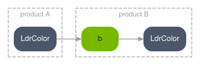

.. SPDX-FileCopyrightText: Copyright (c) 2026 NVIDIA CORPORATION & AFFILIATES. All rights reserved.
.. SPDX-License-Identifier: LicenseRef-NvidiaProprietary
..
.. NVIDIA CORPORATION, its affiliates and licensors retain all intellectual
.. property and proprietary rights in and to this material, related
.. documentation and any modifications thereto. Any use, reproduction,
.. disclosure or distribution of this material and related documentation
.. without an express license agreement from NVIDIA CORPORATION or
.. its affiliates is strictly prohibited.

.. _spg-do-aovs:

Publish, Overwrite and Read Back AOVs
=====================================

**Goal.** Decide what a graph exposes to the rest of the pipeline, and get it back on the host.

**Before you start.** A working node, from :doc:`../first_node`.

The Shape
---------

A RenderVar connects a node's output to a name, and ``orderedVars`` lists what the product
produces:

.. code-block:: usda

    rel orderedVars = [ <LdrColor>, <LdrGrayscale> ]

    def RenderVar "LdrGrayscale"
    {
        uniform string sourceName = "LdrGrayscale"
        opaque omni:rtx:aov.connect = <../GrayscaleKernel.outputs:LdrGrayscale>
    }

How It Works
------------

**A node output ends up in one of three states, and you choose which.** It stays inside the
graph, consumed by another node and readable by nothing else. It is published under a new name, so
the host and other products can read it. Or it is published under a name the renderer already
produces, so existing consumers pick it up without knowing SPG is involved. The first costs nothing
and hides the result. The third changes what everything downstream sees.
An output in none of the three is
consumed by nothing and published as nothing, and the node never runs.

**Publishing a new AOV** needs both parts: a ``sourceName``, which registers the name, and the
connection to the node's output. A RenderVar with only one of them produces nothing.

The grayscale scene publishes one AOV. Highlighted: the ``sourceName`` that registers the name,
the connection that fills it, and the ``orderedVars`` entry that puts it in the product.

.. literalinclude:: ../../../examples/python/spg-grayscale/grayscale_scene.usda
   :language: usda
   :start-after: # [snippet:render-graph]
   :end-before: # [/snippet:render-graph]
   :emphasize-lines: 7, 17-18
   :caption: ``grayscale_scene.usda``, from the runnable :doc:`grayscale example <../../examples/python_spg_grayscale>`

**Read it back like a built-in AOV.** The example saves its input and its output with the same call:

.. filtered-literalinclude:: ../../../examples/python/spg-grayscale/main.py
   :language: python
   :start-after: # [snippet:spg-read-output-aov]
   :end-before: # [/snippet:spg-read-output-aov]
   :omit-markers:
   :caption: ``main.py``, from the runnable :doc:`grayscale example <../../examples/python_spg_grayscale>`

**Overwriting an existing AOV** is the same wiring with the renderer's own name. The producing node
may sit in the same product or in another one:

Four rules constrain those choices.

**A node cannot read an AOV and republish it under that same name in the same product.** Read one
name and publish another, or put the producer in a different product.

**The same name in two products is two different AOVs.** Each product's RenderVar receives its own
graph's result, and one may be the source for the other's.

.. _spg-aov-collision:

**Names collide silently.** If a ``sourceName`` matches an AOV the renderer already produces
and you did not intend to overwrite it, the node's output replaces the renderer's. Give it a name
of its own.

**One output, one RenderVar.** A node output can be bound to a single RenderVar at a time.

Verify It Worked
----------------

Read the published AOV back and check an invariant only your node can produce. For a grayscale
node that is ``R == G == B`` in every pixel, which the renderer's own ``LdrColor`` will not
satisfy. An AOV that is present but fails the invariant means you are reading the built-in output
under that name rather than yours. Check the input as well: on a scene that is already grey,
the invariant holds even if the node never ran.

When It Goes Wrong
------------------

Refer to :ref:`Nothing Appears <spg-symptom-nothing>`, which lists the causes in the order worth checking.

Related
-------

:doc:`chaining`, :doc:`products`, :doc:`../ref/usd`
