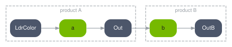
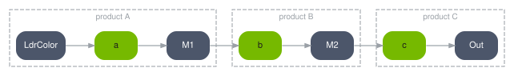
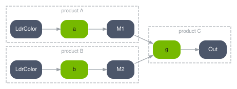
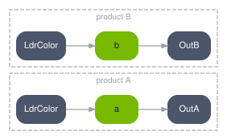

.. SPDX-FileCopyrightText: Copyright (c) 2026 NVIDIA CORPORATION & AFFILIATES. All rights reserved.
.. SPDX-License-Identifier: LicenseRef-NvidiaProprietary
..
.. NVIDIA CORPORATION, its affiliates and licensors retain all intellectual
.. property and proprietary rights in and to this material, related
.. documentation and any modifications thereto. Any use, reproduction,
.. disclosure or distribution of this material and related documentation
.. without an express license agreement from NVIDIA CORPORATION or
.. its affiliates is strictly prohibited.

.. _spg-do-products:

Work Across Render Products
===========================

**Goal.** Read an AOV produced by a different RenderProduct, or drive several products in one
step.

**Before you start.** :doc:`aovs`.

The Shape
---------

A node under one product can read an AOV published by another. Dashed boxes are RenderProducts.

**A cross-product edge.** ``B`` reads an AOV that ``A`` published.

**A chain of three.** Each product's result feeds the next, so SPG orders all three.

**Two products into one node.** ``g`` runs after both producers, wherever they live.

**Independent products.** No edge crosses, so nothing orders one against the other.

A graph is authored under a RenderProduct, and a scene may carry several. Each has its own
camera and its own :doc:`orderedVars <aovs>`, the list of AOVs it produces.

Inside one product, a node reads a RenderVar by a relative path. Across products, the same
connection carries an absolute one, naming the product it comes from:

.. code-block:: usda

    opaque inputs:Image.connect = <../LdrColor.omni:rtx:aov>            # this product
    opaque inputs:Edges.connect = </Render/Camera/Edges.omni:rtx:aov>   # another product

How It Works
------------

Two products, and one edge between them. ``Camera`` renders the scene, runs a node over its
``LdrColor`` and publishes the result as ``Edges``. ``Overlay`` runs a second node that reads
that published AOV and publishes its own. Highlighted: the RenderVar that makes the result
readable outside its own product, and the connection that reaches it.

.. code-block:: usda
   :emphasize-lines: 15, 41

    def Scope "Render"
    {
        def RenderProduct "Camera"
        {
            uniform int2 resolution = (1280, 720)
            rel camera = </World/Camera>
            rel orderedVars = [ <LdrColor>, <Edges> ]

            def RenderVar "LdrColor"
            {
                uniform string sourceName = "LdrColor"
                opaque omni:rtx:aov
            }

            def RenderVar "Edges"
            {
                uniform string sourceName = "Edges"
                opaque omni:rtx:aov.connect = <../EdgeKernel.outputs:Edges>
            }

            def Shader "EdgeKernel" ( references = @EdgeKernel.usda@ )
            {
                opaque inputs:Image.connect = <../LdrColor.omni:rtx:aov>
            }
        }

        def RenderProduct "Overlay"
        {
            uniform int2 resolution = (1280, 720)
            rel camera = </World/OverlayCamera>
            rel orderedVars = [ <Composited> ]

            def RenderVar "Composited"
            {
                uniform string sourceName = "Composited"
                opaque omni:rtx:aov.connect = <../CompositeKernel.outputs:Result>
            }

            def Shader "CompositeKernel" ( references = @CompositeKernel.usda@ )
            {
                opaque inputs:Edges.connect = </Render/Camera/Edges.omni:rtx:aov>
            }
        }
    }

**An intermediate has to be published to cross.** Inside a product a node reads another node's
``outputs:`` port directly, and nothing else sees it. Across products there is no such edge: the
producing node's result needs a RenderVar and a place in that product's ``orderedVars`` before
anything outside can name it.

**Each product needs its own camera**, including one that only hosts nodes.

**One step fills every product you ask for.** Pass them together rather than stepping each in
turn, so the frame is shared:

.. code-block:: python

    products = renderer.step(
        render_products={"/Render/Camera", "/Render/Overlay"},
        delta_time=STEP_DT,
        ordinal=ordinal,
    )

**Each product runs its own graphs.** Nodes under a product see that product's AOVs.

**Reaching another node's result is a choice between two edges with different costs.** Inside one
product, a direct connection is exact and same-frame; refer to :doc:`chaining`. Across products, the
same dependency is carried by a RenderVar and can lag by a frame. If a result has to be current
within the frame, that is an argument for keeping both nodes under one product, not for accepting
the lag.

**A node can read another product's output.** SPG orders the graphs so the producer runs
first where it can.

.. _spg-cross-product-stale:

**A cross-product read can be one frame stale.** When the consuming product renders before the
producing one, the value read is the previous frame's. It converges once the dependency has
rendered. If a result must be current within the frame, keep both nodes under one product and
chain them instead.

Verify It Worked
----------------

Step both products, then compare the consumer's output against the producer's for the same
frame. A one-frame lag shows as the consumer trailing by exactly one step when something in
the scene moves.

When It Goes Wrong
------------------

Refer to :ref:`Something Is Stale or Late <spg-symptom-stale>`.

Related
-------

:doc:`aovs`, :doc:`chaining`, :doc:`../ref/usd`
