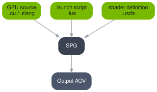

.. SPDX-FileCopyrightText: Copyright (c) 2026 NVIDIA CORPORATION & AFFILIATES. All rights reserved.
.. SPDX-License-Identifier: LicenseRef-NvidiaProprietary
..
.. NVIDIA CORPORATION, its affiliates and licensors retain all intellectual
.. property and proprietary rights in and to this material, related
.. documentation and any modifications thereto. Any use, reproduction,
.. disclosure or distribution of this material and related documentation
.. without an express license agreement from NVIDIA CORPORATION or
.. its affiliates is strictly prohibited.

.. _spg-overview:

Overview
========

Sensor Processing Graphs (SPG) enables running custom GPU code as post-processing passes on RTX
render outputs (Arbitrary Output Variables, or AOVs). You write a CUDA kernel or a Slang shader,
describe its launch configuration in a Lua script, declare its interface in USD, and wire it into
a RenderProduct. All computation stays on the GPU; there is no CPU-side data transfer in the
processing pipeline.

This guide assumes proficiency with CUDA kernel programming or Slang Shader programming and basic familiarity
with USD (Universal Scene Description).

How SPG Works
-------------

Every SPG node is defined by three files:

.. list-table::
   :header-rows: 1
   :widths: 22 78

   * - File
     - Role
   * - ``.cu`` or ``.slang``
     - **GPU source.** The transform you write, in CUDA or in Slang.
   * - ``.cu.lua`` or ``.slang.lua``
     - **Lua launch script.** Named after the GPU source. Tells SPG how to validate the inputs, what
       the outputs have to be, and how to launch the GPU code.
   * - ``.usda``
     - **USD shader definition.** Declares the SPG node with its inputs and outputs in USD and references the GPU source.
       Wired into the render graph.

Finding Your Way
----------------

The pages after this one come in four kinds:

.. list-table::
   :header-rows: 1
   :widths: 22 78

   * - Section
     - Purpose
   * - :doc:`first_node`
     - **Walkthrough.** Builds one node from nothing, in order, once.
   * - :doc:`How-To <do/index>`
     - **One page per task.** Find the one you need. Not written to be read in
       sequence.
   * - :doc:`Reference <ref/index>`
     - **Lookup.** Every Lua function and every USD attribute you can author.
   * - :doc:`Troubleshooting <diagnose/index>`
     - **Symptoms.** Starts from what you observed rather than from what you meant to do.
