# ovrtx Examples

This directory contains example projects demonstrating various features of ovrtx.

Camera feature examples:

- [`python/aov-compositing`](python/aov-compositing/) captures seven Path Tracing lighting passes, reconstructs beauty, and compares it with the rendered image.

- [`python/camera-calibration`](python/camera-calibration/) fits camera intrinsics from supplied checkerboard photographs and writes a USD Camera.
- [`python/camera-lens-calibration`](python/camera-lens-calibration/) compares OpenCV pinhole, OpenCV fisheye, and omni-directional stereo cameras.
- [`python/camera-rolling-shutter`](python/camera-rolling-shutter/) compares global and rolling shutters.
- [`python/multi-rate-sensors`](python/multi-rate-sensors/) keeps two lidars and two cameras active at different capture rates and compares partial-output policies.
- [`c/sensor-observer`](c/sensor-observer/) combines a 30 Hz sensor camera with an interactive observer that can move while simulation is paused.
- [`python/camera-scene-partitions`](python/camera-scene-partitions/) renders isolated environments from one stage.
- [`python/debug-views`](python/debug-views/) renders every RT2 G-buffer debug view and logs them together to Rerun.
- [`python/minimal-dlss`](python/minimal-dlss/) and [`c/minimal-dlss`](c/minimal-dlss/) render Minimal mode with optional DLSS-SR, DLSS-RR, or native-resolution DLAA.

Light feature examples:

- [`python/spectral-rendering`](python/spectral-rendering/) and [`c/spectral-rendering`](c/spectral-rendering/) compare physical illuminants in RGB and spectral PathTracing.

- [`python/projector-light-calibration`](python/projector-light-calibration/) generates an OpenCV-calibrated projector direction texture and renders it.

Material feature examples:

- [`python/runtime-textures`](python/runtime-textures/) drives NVIDIA Carter in a circle and uses Warp to display its previous camera frame in greyscale on a monitor. The [`c/runtime-textures`](c/runtime-textures/) example demonstrates simple CUDA texel updates.

Nonvisual sensor configurations:

- [`python/generic-wpm`](python/generic-wpm/) runs small depth, scan, Gaussian, multistatic, acoustic and stored-pattern recipes.
- [`c/generic-wpm`](c/generic-wpm/) reads contributions through the C API, filters valid records and exercises live selection updates.

## Example Projects

<table>
  <tr>
    <td align="center" width="50%">
      
       
      <b>Minimal</b>
       
      <blockquote>
        
<em>“Create the smallest useful ovrtx example that loads an existing USD scene, renders one camera frame, maps the color output, and saves or displays the result while cleaning up resources appropriately.”</em>

      </blockquote>
      Build &amp; run in: <a href="c/minimal/">C →</a>, <a href="python/minimal/">Python →</a>
    </td>
    <td align="center" width="50%">
      
       
      <b>Status Queries</b>
       
      <blockquote>
        
<em>“Create a rendering example that demonstrates operation status queries, including logging, asynchronous scene loading, progress and counter polling while waiting, shader warmup feedback, final frame rendering, output handling, and error checks.”</em>

      </blockquote>
      Build &amp; run in: <a href="c/status-queries/">C →</a>, <a href="python/status-queries/">Python →</a>
    </td>
  </tr>
  <tr>
    <td align="center" width="50%">
      
       
      <b>Vulkan Interop</b>
       
      <blockquote>
        
<em>“Create a C++ interactive viewer that renders ovrtx camera output directly into a Vulkan presentation path through CUDA interop, with GPU selection, GPU image mapping, exported-image copies, explicit synchronization, double buffering, orbit camera controls, finite-frame capture, and click or marquee picking with selection outlines.”</em>

      </blockquote>
      Build &amp; run in: <a href="c/vulkan-interop/">C →</a>
    </td>
  </tr>
  <tr>
    <td align="center" width="50%">
      
       
      <b>DLSS Frame Generation</b>
       
      <blockquote>
        
<em>“Create a headless C/C++ example that enables DLSS Frame Generation on a RenderProduct, steps a moving scene, reports how many interpolated frames were actually produced versus requested, identifies which output frame is the simulated one, and writes every frame to disk for comparison.”</em>

      </blockquote>
      Build &amp; run in: <a href="c/frame-generation/">C →</a>
    </td>
    <td align="center" width="50%">
      
       
      <b>Planet System</b>
       
      <blockquote>
        
<em>“Create an animation example that loads a base scene, injects generated runtime geometry, creates persistent transform bindings, updates many transforms efficiently each simulation step using CPU or GPU compute, renders frames, optionally streams or saves them, and cleans up bindings explicitly.”</em>

      </blockquote>
      Build &amp; run in: <a href="python/planet-system/">Python →</a>
    </td>
  </tr>
  <tr>
    <td align="center" width="50%">
      
       
      <b>Tiled Rendering</b>
       
      <blockquote>
        
<em>“Create an example that composes multiple referenced scene instances into a grid, assigns per-instance visual variation at runtime, renders all cameras through one tiled output, warms up for image quality, and saves or displays the final tiled image.”</em>

      </blockquote>
      Build &amp; run in: <a href="python/tiled-rendering/">Python →</a>
    </td>
    <td align="center" width="50%">
      
       
      <b>Semantic Segmentation</b>
       
      <blockquote>
        
<em>“Create an example that composes an existing scene with semantic label overrides and camera annotation outputs, renders several camera AOVs including semantic segmentation and its ID map, decodes metadata into human-readable labels, logs a useful visual layout to a viewer, and supports headless image export.”</em>

      </blockquote>
      Build &amp; run in: <a href="python/semantic-segmentation/">Python →</a>
    </td>
  </tr>
  <tr>
    <td align="center" width="50%">
      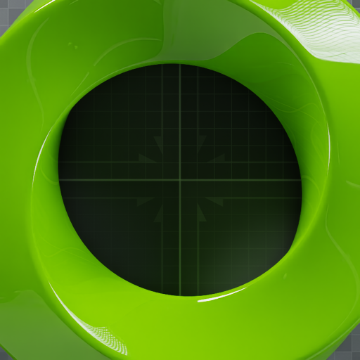
       
      <b>Crop Window</b>
       
      <blockquote>
        
<em>“Create an example that renders a centered dataWindowNDC crop from a full-resolution RenderProduct, verifies the cropped output dimensions, and saves or displays the result.”</em>

      </blockquote>
      Build &amp; run in: <a href="python/crop-window/">Python →</a>
    </td>
    <td align="center" width="50%">
      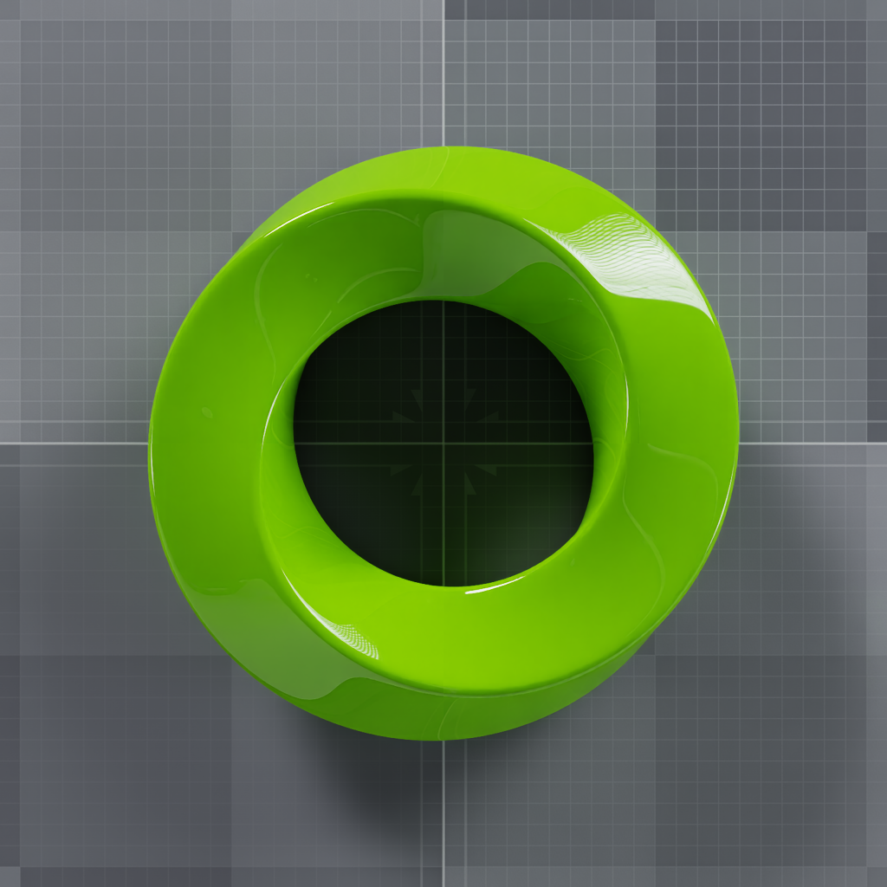
       
      <b>Sliced Rendering</b>
       
      <blockquote>
        
<em>“Render one image as four successive dataWindowNDC crops, warm up each crop, and stitch the captured TL, TR, BL, and BR tiles into a full-resolution image.”</em>

      </blockquote>
      Build &amp; run in: <a href="python/sliced-rendering/">Python →</a>
    </td>
  </tr>
  <tr>
    <td align="center" width="50%">
      
       
      <b>Lidar Sensor</b>
       
      <blockquote>
        
<em>“Create a lidar sensor example that applies required sensor runtime settings as needed, loads a configured lidar scene, warms up the sensor pipeline, renders one point-cloud output, reads valid point data safely through the count channel, prints summary statistics, and cleans up resources appropriately.”</em>

      </blockquote>
      Build &amp; run in: <a href="c/sensors/lidar/">C →</a>, <a href="python/sensors/lidar/">Python →</a>
    </td>
    <td align="center" width="50%">
      
       
      <b>Radar Sensor</b>
       
      <blockquote>
        
<em>“Create a radar sensor example that applies required runtime settings as needed, loads an animated radar scene, advances scene time across several simulation steps, reads valid detections including signal strength and signed radial velocity, prints per-step summaries, and cleans up resources appropriately.”</em>

      </blockquote>
      Build &amp; run in: <a href="c/sensors/radar/">C →</a>, <a href="python/sensors/radar/">Python →</a>
    </td>
  </tr>
  <tr>
    <td align="center" width="50%">
      
       
      <b>Material Editor</b>
       
      <blockquote>
        
<em>“Create a C++ Qt desktop application that combines live ovrtx rendering with read-only USD material introspection, showing materials, a rendered viewport, a shader graph, and editable shader properties, while keeping runtime material edits and rendering resets separate from introspection.”</em>

      </blockquote>
      Build &amp; run in: <a href="c/material-editor/">C →</a>
    </td>
    <td align="center" width="50%">
      
       
      <b>Projectors</b>
       
      <blockquote>
        
<em>“Create an example that loads an authored projector-mapping scene without editing it, warms up the renderer, renders one frame, and saves the result as a PNG.”</em>

      </blockquote>
      Build &amp; run in: <a href="python/projectors/">Python →</a>
    </td>
  </tr>
  <tr>
    <td align="center" width="50%">
      <b>Light Path Expressions</b>
       
      <blockquote>
        
        
<em>“Create a compact ovrtx example that composes an existing scene with reflection, transmission, and caustics LPE RenderVars, renders them with HdrColor, and records sRGB uint8 images.”</em>

      </blockquote>
      Build &amp; run in: <a href="python/lpes/">Python →</a>
    </td>
    <td align="center" width="50%">
      
       
      <b>Decals</b>
       
      <blockquote>
        
<em>“Create a minimal example that loads USD-authored decals through a runtime stage, renders them, and saves the color output.”</em>

      </blockquote>
      Build &amp; run in: <a href="c/decals/">C →</a>, <a href="python/decals/">Python →</a>
    </td>
  </tr>
  <tr>
    <td align="center" width="50%">
      
       
      <b>Projector Light Calibration</b>
       
      <blockquote>
        
<em>“Generate an OpenEXR projector direction texture from an OpenCV camera matrix and distortion vector, then render the calibrated projection.”</em>

      </blockquote>
      Build &amp; run in: <a href="python/projector-light-calibration/">Python →</a>
    </td>
    <td></td>
  </tr>
  <tr>
    <td align="center" width="50%">
      
       
      <b>Video Textures</b>
       
      <blockquote>
        
<em>“Create a video-texture example with a visible timestamp and moving object, render several source times, and make the results playable in Rerun.”</em>

      </blockquote>
      Build &amp; run in: <a href="python/video-textures/">Python →</a>
    </td>
    <td align="center" width="50%"></td>
  </tr>
  <tr>
    <td align="center" width="50%">
      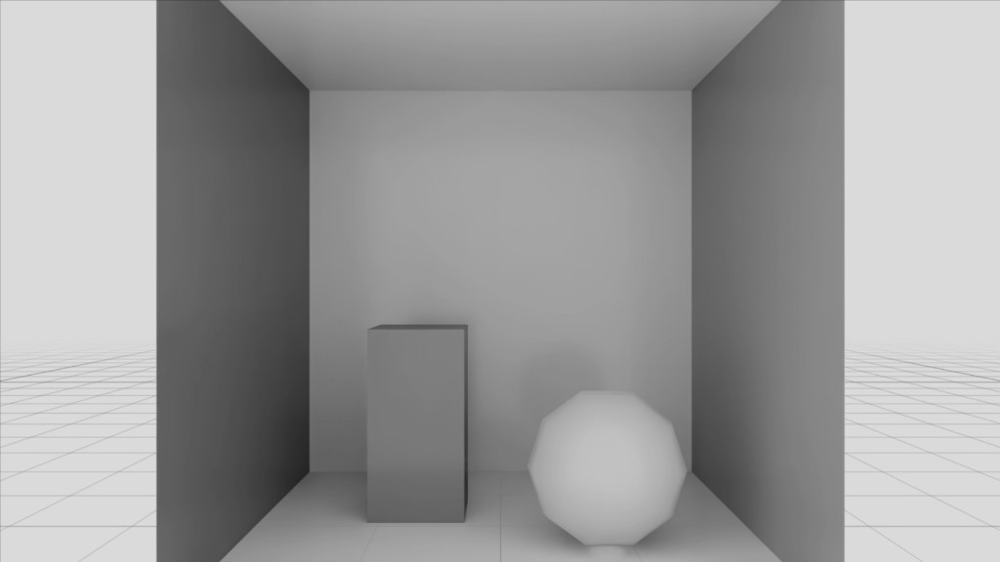
       
      <b>SPG: Grayscale</b>
       
      <blockquote>
        
<em>“Create the smallest useful SPG example: a CUDA kernel that converts the LdrColor render output to grayscale, wired into a RenderProduct and read back from Python as a new AOV.”</em>

      </blockquote>
      Build &amp; run in: <a href="python/spg-grayscale/">Python →</a>
    </td>
    <td align="center" width="50%">
      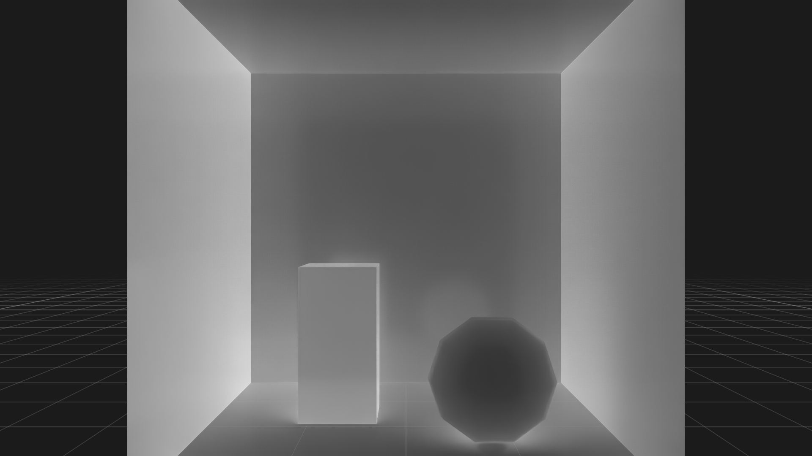
       
      <b>SPG: Pipeline</b>
       
      <blockquote>
        
<em>“Chain two SPG shaders so the renderer's color output is converted to grayscale and then inverted in a single RenderProduct, reading back only the final result.”</em>

      </blockquote>
      Build &amp; run in: <a href="python/spg-pipeline/">Python →</a>
    </td>
  </tr>
  <tr>
    <td align="center" width="50%">
      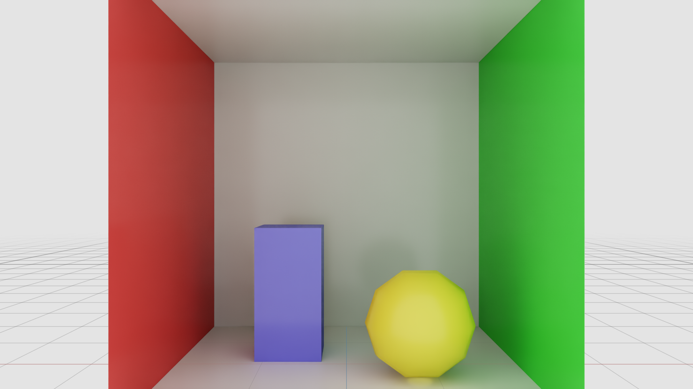
       
      <b>SPG: Built-in Nodes</b>
       
      <blockquote>
        
<em>“Chain two built-in SPG nodes (no custom CUDA) that brighten the color output and downscale it to half resolution, wired into a RenderProduct via info:id.”</em>

      </blockquote>
      Build &amp; run in: <a href="python/spg-builtin-nodes/">Python →</a>
    </td>
    <td align="center" width="50%">
      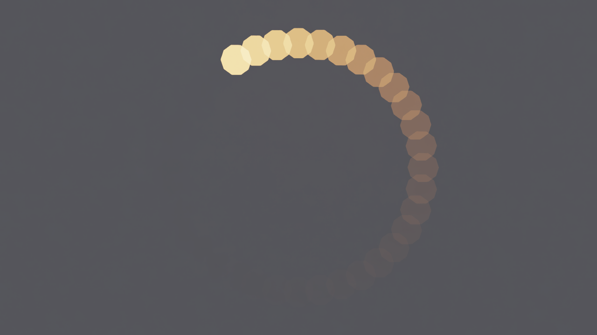
       
      <b>SPG: Stateful Node</b>
       
      <blockquote>
        
<em>“Make an SPG node read back its own previous output, so a moving object drags a fading trail behind it.”</em>

      </blockquote>
      Build &amp; run in: <a href="python/spg-stateful/">Python →</a>
    </td>
  </tr>
  <tr>
    <td align="center" width="50%">
      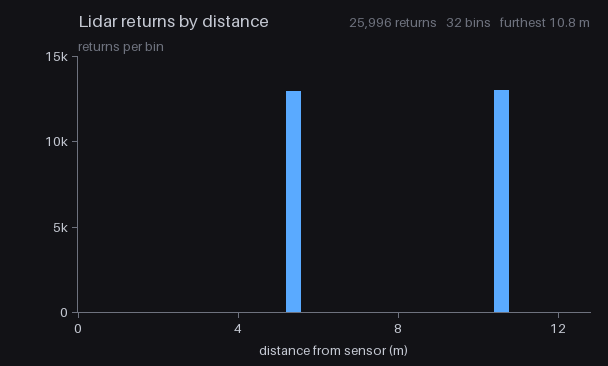
       
      <b>SPG: Composite AOV</b>
       
      <blockquote>
        
<em>“Feed an SPG node from a lidar instead of a camera, reading the point cloud's named channels and publishing a histogram of returns by distance.”</em>

      </blockquote>
      Build &amp; run in: <a href="python/spg-composite-aov/">Python →</a>
    </td>
    <td align="center" width="50%">
      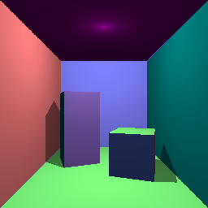
       
      <b>SPG: Ray Generation</b>
       
      <blockquote>
        
<em>“Have an SPG node trace the scene itself: a Cornell box with ray-traced shadows and the geometric normal recovered from probe rays alone.”</em>

      </blockquote>
      Build &amp; run in: <a href="python/spg-raygen/">Python →</a>
    </td>
  </tr>
  <tr>
    <td align="center" width="50%">
      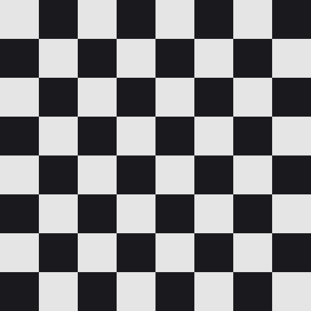
       
      <b>SPG: Generating Node</b>
       
      <blockquote>
        
<em>“Write an SPG node with no input AOV that draws a checkerboard from typed USD attributes, and publish it as a render output.”</em>

      </blockquote>
      Build &amp; run in: <a href="python/spg-generate/">Python →</a>
    </td>
    <td align="center" width="50%">
      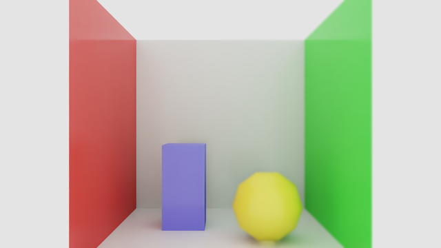
       
      <b>SPG: Separable Blur</b>
       
      <blockquote>
        
<em>“Chain two SPG nodes into a separable blur whose tap weights are built once in the launch script, and retune the radius from the host between renders.”</em>

      </blockquote>
      Build &amp; run in: <a href="python/spg-blur/">Python →</a>
    </td>
  </tr>
  <tr>
    <td align="center" width="50%">
      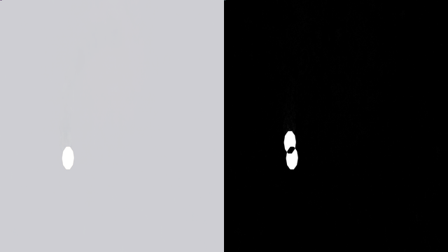
       
      <b>SPG: Previous Frame</b>
       
      <blockquote>
        
<em>“Have an SPG node read the same AOV twice, once live and once a frame back, and publish the difference so only what moved lights up.”</em>

      </blockquote>
      Build &amp; run in: <a href="python/spg-previous-frame/">Python →</a>
    </td>
    <td align="center" width="50%">
      <b>USD Plugin Paths</b>
       
      <blockquote>
        
Register ovrtx schemas with external OpenUSD and verify a fallback value in Python. Use C/C++ to enumerate schema directories and publish paths for the bundled USD runtime.

      </blockquote>
      Build &amp; run in: <a href="python/usd-plugin-paths/">Python →</a> | <a href="c/usd-plugin-paths/">C →</a>
    </td>
  </tr>
  <tr>
    <td align="center" width="50%">
      
       
      <b>Spectral Rendering</b>
       
      
Compare physical illuminants in RGB and spectral PathTracing, then compare Canon EOS 5D and Sony α7 IV camera responses with the CIE 1931 observer.

      Build &amp; run in: <a href="c/spectral-rendering/">C →</a>, <a href="python/spectral-rendering/">Python →</a>
    </td>
    <td align="center" width="50%">
      
       
      <b>Custom Selection with SPG</b>
       
      
Draw custom selection outlines, stippling, and hatching from the output-resolution SelectionState AOV using an SPG graph.

      Build &amp; run in: <a href="c/selection-spg/">C →</a>
    </td>
  </tr>
</table>

## Gaussian Splats

- [Python](python/gaussian-splats/): runnable scene and validation.
- [C](c/gaussian-splats/): equivalent runtime workflow.
