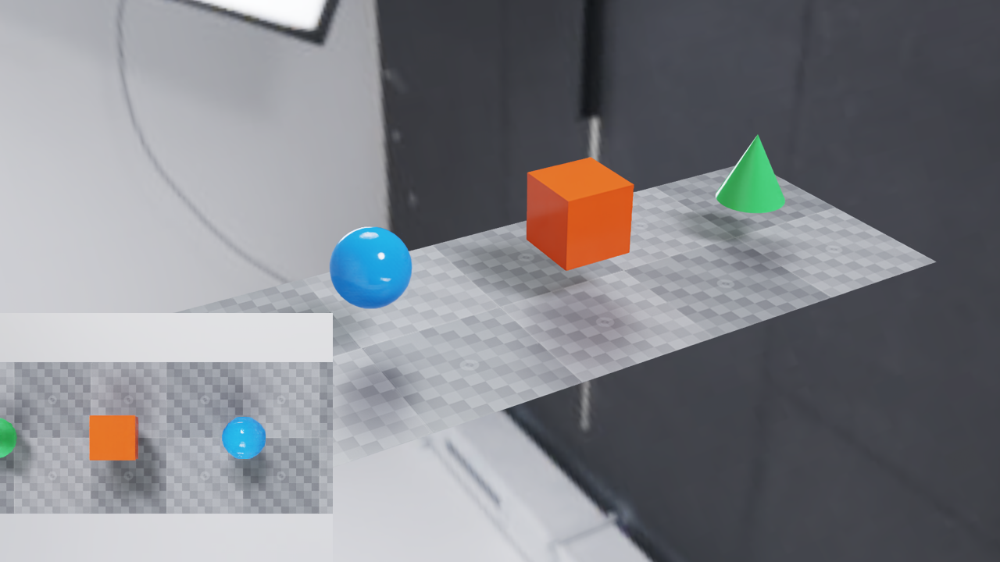

# Simulated Camera and Observer

This example shows how to combine a simulated camera running at a specified tick rate,
while an interactive camera observes the scene, rendering as fast as the
display allows.



*The observer can move while the inset retains the last 30 Hz sensor image.*

The sensor camera inspects a conveyor belt with items passing along it. The sensor
camera uses `OmniSensorAPI` to set `double2 omni:sensor:frameRate = (30, 1)`,
which schedules it for 30Hz updates: frames will be returned from the sensor when
they are ready, regardless of the intervals at which the simulation is stepped.

For simplicity, the simulation is also stepped at 30Hz, though this is not necessary
for the sensor camera to operate correctly.

The observer camera provides an interactive view of the scene. It is updated in
response to mouse input from the user, whenever those inputs are available, and is
stepped immediately with `delta_time=0` so those updates happen independent of the
simulation. Frames are returned from the observer camera as soon as they are ready.

The observer camera's image is drawn to the viewport as fast as the display allows,
and the sensor camera's image is drawn as an inset 30 times per second.

See [multi-rate sensors](../../../docs/sensors/multi_rate.rst) for the scheduling contract.

## Build and Run

Use a C++17 compiler, CMake, CUDA Toolkit, a Vulkan SDK with `glslc` or
`glslangValidator`, and an NVIDIA RTX GPU with a supported driver. A windowed
run also needs a desktop display. Run outside a GPU-restricting sandbox.
The example reuses the graphics helpers in the adjacent `vulkan-interop`
directory; keep both directories and `tests/docs/data` in the checkout.
The scene uses local geometry and the local `studio.exr` dome texture.

From `examples/c/sensor-observer`, build and launch the executable:

```bash
cmake -S . -B build -DCMAKE_BUILD_TYPE=Release
cmake --build build --config Release
# Run the 30 Hz sensor with an interactive observer and pause/resume controls.
./build/sensor-observer
```

For an X11-only GLFW source build on Linux, add `-DGLFW_BUILD_WAYLAND=OFF`.
On Windows with a multi-configuration generator, run
`build\Release\sensor-observer.exe`. CMake finds installed ovrtx and ovstage
packages or downloads the versions pinned by the sibling CMake helpers.

* Right-drag: orbit the observer.
* Mouse wheel: zoom.
* Space: pause or resume simulation.
* Escape: exit.

Run without a window to exercise the same rendering and CUDA/Vulkan image-copy
path and export a composite PNG and capture-time CSV:

```bash
# Check sensor timing with two observer updates per step; export both views and timestamps.
./build/sensor-observer --headless --num-steps 30 --observer-steps 2 \
    --png output.png --report timing.csv
```

This runs one simulated second, adds two zero-time observer updates after each
simulation step, and inserts twelve extra observer updates at the midpoint.
It checks for 30 sensor images with capture times from 1/30 through 1 second,
and no extra sensor captures on zero-time updates. Use `--observer-steps 0`
for the comparison without observer updates. Headless mode copies the two GPU
images back to assemble the PNG; windowed mode composites them in Vulkan.

The CSV report includes `wall_time` in seconds since the render loop started,
alongside simulation and capture times. Use it to compare the wall-clock rate
of observer updates with the simulation and inspection rates. The first frame
can include shader compilation; exclude that startup interval when measuring
steady-state FPS. Headless mode checks capture timing without display pacing.

### Optional: Pixi

If you already have [Pixi](https://pixi.prefix.dev/latest/installation/)
installed, you can use it to provision CUDA 12.9,
Vulkan, and the build tools on Linux or Windows x86-64. On Windows, you still
need Visual Studio 2022 with the Desktop development with C++ workload and
Windows SDK installed.

From `examples/c/sensor-observer`:

```bash
pixi run build
pixi run main
```

The `build` task depends on `configure`. The `main` task launches the
existing executable. Run `pixi run build` after changing source code.

## Schedule the Cameras

Only the top-down camera has `OmniSensorAPI` and a positive frame rate.
Both use instantaneous global-shutter captures; the observer has no scheduled
rate or long exposure. The scene declares these cameras as follows:

```usda
def Camera "Sensor" (prepend apiSchemas = ["OmniSensorAPI"])
{
    # Instant global-shutter captures at 30 Hz of simulation time.
    double2 omni:sensor:frameRate = (30, 1)
    # Cameras do not provide partial outputs
    bool omni:sensor:Core:partialOutputs = false
    float focalLength = 24
    double3 xformOp:translate = (0, 1000, 0)
    float3 xformOp:rotateXYZ = (-90, 0, 0)
    uniform token[] xformOpOrder = ["xformOp:translate", "xformOp:rotateXYZ"]
}

def Camera "Observer"
{
    # No sensor frame rate or exposure: render even when delta_time is zero.
    float focalLength = 24
    double3 xformOp:translate = (900, 700, 1000)
    float3 xformOp:rotateXYZ = (-28, 42, 0)
    uniform token[] xformOpOrder = ["xformOp:translate", "xformOp:rotateXYZ"]
}
```

## Refresh Without Advancing Simulation

Keep both RenderProducts in every call, including observer-only refreshes.
Omitting the sensor product discards its accumulated rendering history and
requires expensive initialization when it is requested again. The loop selects
a positive delta for simulation steps and zero for observer-only refreshes:

```cpp
// Publish scene/camera changes. An ordinal does not itself advance
// simulation time.
publish(stage, ordinal);
ovx_string_t product_paths[] = {text("/Render/Sensor"),
                                text("/Render/Observer")};
ovrtx_render_product_set_t products{};
products.render_products = product_paths;
products.num_render_products = 2;
// Keep both products selected even for a view-only refresh,
// preserving sensor history.
const double delta_time = simulate ? simulation_dt : 0.0;
Results results(renderer);
check_rtx(ovrtx_step_with_stage(
    renderer, products, delta_time, ordinal, &results.handle));
ovrtx_render_product_set_outputs_t outputs{};
check_rtx(ovrtx_fetch_results(
    renderer, results.handle, ovrtx_timeout_infinite, &outputs));
```

The sample starts with a positive simulation step. A zero-time step exactly at
the scheduled camera's initial `startTime` can trigger its instantaneous
capture; this is not a way to warm up the observer without touching sensors.

## Display the Last Completed Image

The window keeps a separate CUDA/Vulkan image for each camera. The sensor image
is overwritten only when a completed output arrives. Before copying, the loop
waits for the preceding Vulkan presentation fence, then waits for the mapped
ovrtx output's CUDA event. It completes the copy before unmapping the output
and signals a timeline semaphore before Vulkan samples the shared images.
This deliberately serial loop keeps ownership visible; see
[CUDA/Vulkan interop](../../../docs/examples/c_vulkan_interop.rst) for the larger interop example and
[CUDA/Vulkan scheduling](../../../docs/core/cuda_vulkan_scheduling.rst) for the Linux scheduling workaround.

The following block updates the texture only for returned frames:

```cpp
// Only replace the sensor texture when a newly completed
// image is returned.
for (size_t v = 0; v < frame.render_var_count; ++v) {
    Mapping mapping(renderer, cuda.stream);
    ovrtx_map_output_description_t map_desc{};
    map_desc.device_type = OVRTX_MAP_DEVICE_TYPE_CUDA_ARRAY;
    check_rtx(ovrtx_map_render_var_output(
        renderer,
        frame.output_render_vars[v].output_handle,
        &map_desc,
        ovrtx_timeout_infinite,
        &mapping.output));
    const auto& output = mapping.output;
    if (output.cuda_sync.wait_event) {
        check_cuda(cuStreamWaitEvent(
            cuda.stream,
            reinterpret_cast<CUevent>(
                output.cuda_sync.wait_event),
            0));
    }
    const int width = is_sensor ? sensor_width : view_width;
    const int height =
        is_sensor ? sensor_height : view_height;
    if (!output.num_tensors ||
        output.tensors[0].dl->device.device_id != 0 ||
        output.tensors[0].dl->shape[0] != height ||
        output.tensors[0].dl->shape[1] != width) {
        throw std::runtime_error(
            "Unexpected image dimensions");
    }
    if (!cuda_copy_array_to_surface(
            is_sensor ? 1 : 0,
            reinterpret_cast<CUarray>(
                output.tensors[0].dl->data),
            width,
            height,
            CudaImageFormat::UInt8_4,
            cuda.stream)) {
        throw std::runtime_error("CUDA image copy failed");
    }
    check_cuda(cuStreamSynchronize(cuda.stream));
    // Mapping releases the output after the copy; Results
    // releases step metadata.
}
if (is_sensor) {
    have_sensor = true;
}
```

Changing the observer does not advance the scene animation or sensor clock.
