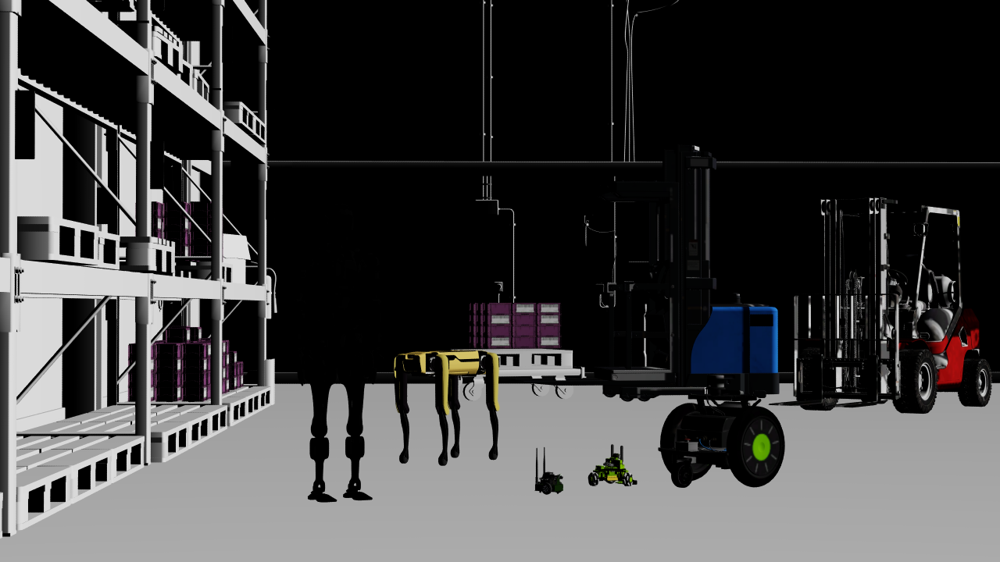

# Minimal DLSS

Render `ovrtx-robot-lineup.usda` with optional DLSS. The output is
1280 × 720. Keep the same scene and camera when comparing reconstruction modes.
Shadows are disabled to keep the small robots visible inside the warehouse.



## Run

Internet access is required to load the scene's robot and warehouse assets.

```bash
uv run main.py
uv run main.py --dlss-mode 0 --no-rr --png _output/none.png
uv run main.py --dlss-mode 1 --exec-mode quality --no-rr --png _output/sr.png
uv run main.py --dlss-mode 2 --exec-mode quality --no-rr --png _output/rr.png
uv run main.py --dlss-mode 1 --exec-mode rtxaa --no-rr --png _output/dlaa.png
uv run main.py --rrd _output/minimal-dlss.rrd
```

`--dlss-mode` selects disabled (0), DLSS-SR (1), or DLSS-RR (2).
`--exec-mode` selects `auto`, `performance`, `balanced`, `quality`, or `rtxaa`
(native-resolution DLAA). The default is DLSS-SR with Quality. The example
renders 32 frames to build temporal history; use `--frames` to change that count.
This textured scene illustrates edge reconstruction, and contains no Gaussian splats.
Use `--log PATH` to save renderer diagnostics. Use `--usd PATH` to render another
scene that defines `/World/Camera` and a `/Render/Camera` RenderProduct with an
`LdrColor` RenderVar; the documentation tests use it with a local scene that needs
no internet access.

See the
[Minimal DLSS documentation](../../../docs/sensors/cameras/render_modes/minimal.rst)
for the available settings and their effects.

## Configure and render

The following code composes the selected settings on `/Render/Camera`, loads
that USD stage, and renders consecutive frames before copying `LdrColor` to CPU
memory. Argument parsing, renderer setup, Rerun logging, and PNG output are in
`main.py`.

```python
# Compose the scene with the selected settings on its RenderProduct.
# --usd swaps in a scene that defines /World/Camera and /Render/Camera with LdrColor.
scene_path = (args.usd or Path(__file__).with_name("minimal_dlss.usda")).resolve()
scene = f"""#usda 1.0
(
    subLayers = [@{scene_path.as_posix()}@]
)
over "Render"
{{
    over "Camera"
    {{
        int omni:rtx:minimal:dlss:mode = {args.dlss_mode}
        token omni:rtx:minimal:dlss:execMode = "{args.exec_mode}"
    }}
}}
"""
ordinal = 1
ovstage.population.open_usd_from_string(stage, scene, ordinal=ordinal)
stage.advance_write_floor(ordinal, ovstage.Scope.ALL).wait()

# Keep the renderer alive across frames so DLSS can build temporal history.
for frame_index in range(args.frames):
    products = renderer.step(
        render_products={"/Render/Camera"},
        delta_time=1.0 / 60.0,
        ordinal=ordinal,
    )
    for frame in products["/Render/Camera"].frames:
        mapped = frame.render_vars["/Render/Camera/LdrColor"].map(device=ovrtx.Device.CPU)
        pixels = np.from_dlpack(mapped).copy()
        mapped.unmap()
        del mapped, frame
    del products
```
