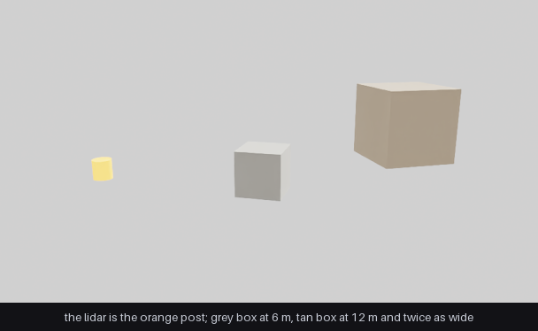
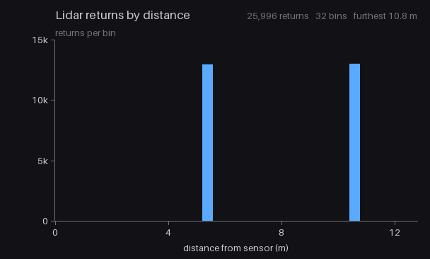

# SPG Composite AOV Example

An SPG node whose input is a lidar rather than a camera.

A lidar `PointCloud` is a **composite AOV**: several named channels published together under
one render var, instead of the single image a camera AOV gives you. This node reads the
`Coordinates` and `Counts` channels, counts the sweep's returns by distance, and publishes a
bar chart on the `Histogram` AOV.

## The two images



`_output/scene.png` is the scene: a sensor post and two boxes. The
orange post marks the sensor, which sits 1 m up at the origin. The grey box is 6 m away and
1.5 m across; the tan box is 12 m away and 3 m across, which is why it looks the larger of
the two. This picture comes from a second render product with an ordinary camera, since the
lidar product's camera is the sensor and has no colour output.

The post itself is inside the sweep's blind zone and never appears in the data. The steepest
beam leaves at -15 degrees elevation, so by the time it reaches the post's radius it is
still 0.91 m up, and the post stops at 0.7 m.



`_output/histogram.png` is what the node produced from the sweep: distance from the sensor
across, returns per bin up. Two bars, one per box, at 5.25 m and 10.5 m. Those are the front
faces, half a box nearer than the centres, because the face is what the beams actually hit.

The two bars come out the same height. The far box is twice as far and
twice as wide, so it covers the same angle of the sweep and collects the same number of
beams. Distance is the only thing separating the two.

The node draws the bars. `main.py` adds the axes, ticks and labels after reading the AOV
back, so what the node publishes stays plain data.

## Why the scene looks like that

**There is no ground.** A flat plane returns from every downward beam, each elevation angle
meeting it at its own distance, and would bury the boxes under near returns. Without it every
return is a box.

**The boxes sit at different bearings.** Head on, the near box would stand exactly in front
of the far one and hide it: at 6 m a 1.5 m box and at 12 m a 3 m box cover the same 14
degrees of azimuth.

**Each box is turned to face the sensor.** This is what puts one bar per box on the chart.
Its front face then lies at a single distance. Left axis aligned at these bearings the far
box smears across a metre of range, because a 3 m wide face seen at an angle has its far
corner further away than its near corner, and its side face further away still.

## Files

| File | Role |
|------|------|
| `RangeHistogramKernel.cu` / `.cu.lua` / `.usda` | The CUDA node: channels arrive as device pointers. |
| `RangeHistogramKernel.slang` / `.slang.lua` / `.slang.usda` | The same node in Slang: channels bind as `StructuredBuffer`. |
| `lidar_scene.usda` | Lidar sensor, geometry, the CUDA graph on `/Render/LidarProduct`, and a camera product for the reference picture. |
| `lidar_scene_slang.usda` | The same scene against the Slang shader definition. It references `lidar_scene.usda` for the world, so the sensor and the boxes are authored once. |

## Prerequisites

- Python 3.10-3.13
- [uv](https://docs.astral.sh/uv/)
- NVIDIA RTX-capable GPU
- Supported NVIDIA driver
- Unsandboxed runtime execution

## Running

```bash
uv run main.py                                 # CUDA
uv run main.py --scene lidar_scene_slang.usda    # Slang
```

A successful run writes `_output/histogram.png`, the node's chart with axes and labels drawn
around it, and `_output/scene.png`, the camera's view of the same scene.

## Two render products

The scene carries two. `/Render/LidarProduct` has the lidar as its camera and produces the
point cloud and the histogram. `/Render/SceneView` has an ordinary camera and produces
`LdrColor` for the reference picture. One `renderer.step()` with both named fills both.

The camera product needs a longer warm-up than the sensor does, because it is path traced
and takes a few steps to settle.

## Channels

| Channel | Shape | Meaning |
|---------|-------|---------|
| `Coordinates` | `[3, Nmax]` | all x, then all y, then all z. Sensor-centred and world-aligned: x forward, y left, z up. |
| `Intensity` | `[Nmax]` | strength of the return, one value per point. |
| `Counts` | `[1]` | one number for the whole sweep: how many entries of the other channels were filled. |
| `TimeOffsetNs` | `[Nmax]` | per point, where in the sweep it was measured. |
| `Flags` | `[Nmax]` | status bits per point; the `VALID` bit (`0x40`) marks a valid return. |

The scene sets `includeInvalidPoints = false` on the sensor, so the sensor model delivers
only valid returns and `Counts` bounds exactly them. Set it to `true` and the arrays come
back capacity-shaped with validity carried by the `Flags` channel, which a consumer then has
to test per point.

Each `renderer.step()` produces one sweep. `Counts[0]` and the channels are refilled every
frame; nothing accumulates.

## Consuming a composite

**The scene asks for the channels it needs.** The `channels` attribute on the `PointCloud`
RenderVar lists them, and each one the lidar supports appears. The lidar adds `Counts` and
`Flags` of its own. This node uses `Coordinates` and `Counts`; the scene also asks for
`Intensity` and `TimeOffsetNs`, which the node leaves untouched and the host can read on its own.

**The shader definition declares an `opaque` port.** Whether the input is a composite
comes from the RenderVar it is connected to, so the same node can be
pointed at a different sensor without editing the shader.

**The launch script discovers the rest:**

```
inputs["PointCloud"].isComposite   -- true only for a composite
                    .tensors[name] -- one resource descriptor per channel
                    .channelNames  -- what this composite actually carries
```

Each channel is a resource descriptor and binds like any other buffer:
`cuda.array(channel)` on CUDA, `slang.StructuredBuffer(channel)` on Slang. That binder name
is the main difference between the two backends; the channels are found the same way on both.

**Bound the work by `Counts`.** `Coordinates` is allocated for the worst case, `[3, Nmax]`,
and only the first `Counts[0]` entries hold a return. The launch script cannot apply the
bound itself: it holds descriptors, not data, so it passes `Counts` to the GPU and the
kernel applies it.

**Mind the stride.** `[3, Nmax]` is all the x values, then all the y, then all the z. The
step from one run to the next is `Nmax`, the allocated capacity, not the number of valid
points. Using the valid count as the stride silently reads the wrong coordinates.

## Parameters

| Input | Default | Effect |
|-------|---------|--------|
| `maxRange` | 12.8 | distance at the right edge of the chart |
| `maxCount` | 15000.0 | bin population at full bar height |
| `numBins` | 32 | distance bins; must divide the 512-pixel width evenly |

32 bins over 12.8 m are 0.4 m wide, which puts each box's front face inside a bin rather
than on a boundary, where the sensor's range noise would split one bar into two.

The labelled chart states how many returns the sweep produced and how far the furthest one is,
which is what `maxRange` and `maxCount` are retuned from for another sensor or scene. `main.py`
holds copies of all three, because it labels the axes from them.

## One thread per output column

Each thread counts the returns in its own distance bin, then writes its whole column
including the background. That costs one pass over the points per column, where a production
histogram would have every point atomically increment a shared bin.

In exchange there are no atomics, no dependence on the output arriving cleared, and no
sensitivity to the order threads run in.

## Motion BVH

A sweep is traced across the tick rather than captured at an instant, so without the motion
BVH the lidar returns no points at all: `Counts` comes back zero and the node publishes an
empty chart instead of failing. `main.py` creates the renderer with
`motion_bvh=ovrtx.MotionBvh.ENABLE`, and the labelled chart states the point count, so a zero is
visible.

## Reading the composite from Python

The composite the node consumed is readable on the host, one tensor per channel:
`pointcloud["Counts"]`, `pointcloud["Coordinates"]`, and so on. See the
`reading-sensor-pointclouds` skill for the general pattern and
`interpreting-lidar-pointclouds` for what each channel means.
