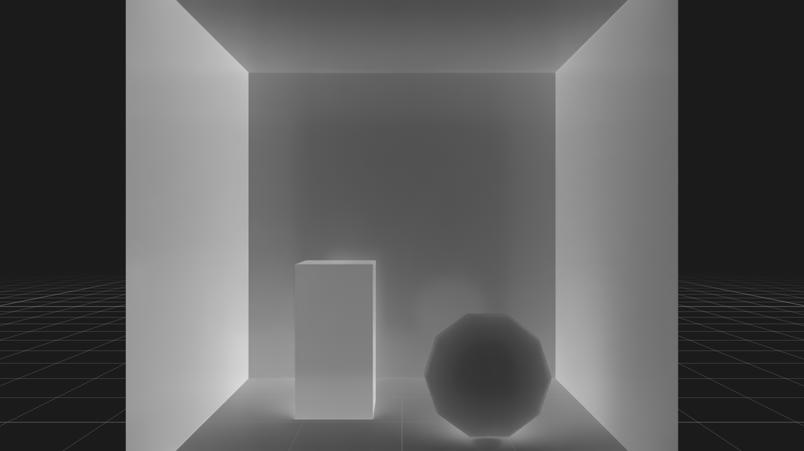

# SPG Pipeline Example

Two SPG shaders chained into a pipeline: `LdrColor` → **Grayscale** → **Invert** →
`LdrInverted`. Shaders are chained by connecting one shader's `outputs:` port directly to the
next shader's `inputs:` port — **no intermediate RenderVar is needed**, so the grayscale result
stays internal to the chain and only the final inverted image is published as an AOV.

Each pass is the same minimal **three-file** SPG shader as the grayscale example, plus a scene
that chains them:

| File | Role |
|------|------|
| `GrayscaleKernel.cu` / `.cu.lua` / `.usda` | First pass: color → grayscale. |
| `InvertKernel.cu` / `.cu.lua` / `.usda` | Second pass: invert the grayscale image (`inputs:Image`); the `inputs:strength` value-input sets how far it is inverted. |
| `pipeline_scene.usda` | Wires `Grayscale.outputs:LdrGrayscale` → `Invert.inputs:Image`. |

SPG runs the shaders in **topological order of the connection graph**, not the order of
`orderedVars`.

> _“Chain two SPG shaders so the renderer's color output is converted to grayscale and then inverted in a single RenderProduct, reading back only the final result.”_



## The same pipeline in Slang

Both nodes are also provided as Slang compute shaders, so the two backends can be compared
side by side:

| CUDA | Slang |
|------|-------|
| `GrayscaleKernel.cu` | `GrayscaleKernel.slang` |
| `GrayscaleKernel.cu.lua` | `GrayscaleKernel.slang.lua` |
| `GrayscaleKernel.usda` | `GrayscaleKernel.slang.usda` |
| `InvertKernel.cu` | `InvertKernel.slang` |
| `InvertKernel.cu.lua` | `InvertKernel.slang.lua` |
| `InvertKernel.usda` | `InvertKernel.slang.usda` |
| `pipeline_scene.usda` | `pipeline_scene_slang.usda` |

The chaining is identical and only the referenced shader definitions differ. `InvertKernel`
also shows how a typed value-input reaches each backend: CUDA passes `strength` as a kernel
argument, while Slang packs it into a constant buffer read through a `ParameterBlock`. Slang
nodes require the renderer to run on the Vulkan backend, which is the default.

## Prerequisites

- Python 3.10-3.13
- [uv](https://docs.astral.sh/uv/)
- NVIDIA RTX-capable GPU
- Supported NVIDIA driver
- Unsandboxed runtime execution

## Running

```bash
uv run main.py                                  # CUDA
uv run main.py --scene pipeline_scene_slang.usda  # Slang
```

The first step compiles both CUDA kernels with NVRTC and may block for up to 5 minutes on a
fresh shader cache. A successful run writes `_output/input.png` (the rendered `LdrColor`) and
`_output/inverted_grayscale.png` (the final SPG output): the input turned grey by the first node
and inverted by the second.

## How it works

- `InvertKernel` mixes both kinds of port: `opaque inputs:Image` is a resource, and typed
  `float inputs:strength` is a value read by the launch script and passed to the GPU.
- The final AOV is read back exactly like a built-in render var:
  `frame.render_vars["/Render/PipelineDemo/LdrInverted"].map(device=ovrtx.Device.CPU)`.
- To inspect the intermediate grayscale result, publish it as its own RenderVar and add it to
  `orderedVars`.

See the `spg` skill and the **Sensor Processing Graphs** section of the docs
for the full authoring reference.
